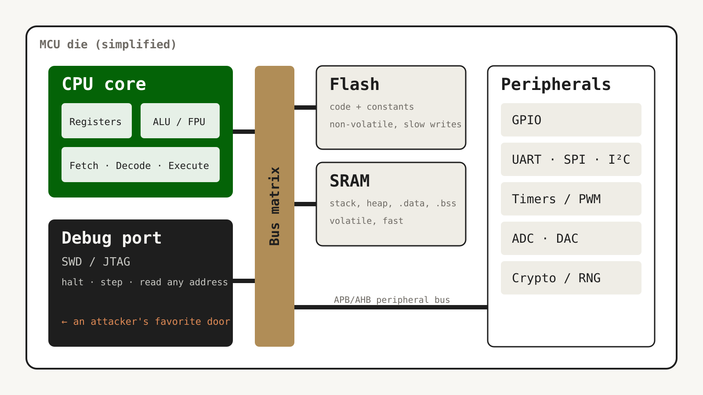

## Plain Markdown is the default

- `## Heading` starts a new slide; `# Heading` starts a section
- Lists, **bold**, `code`, links, tables, and images all just work
- Speaker notes go in a `notes` block (press **S** to open them)

::: notes
These notes only show up in the speaker view. Press S in the browser.
:::

## Build a list one step at a time

::: incremental
- Each bullet appears on a click
- Wrap the list in `::: incremental`
- Or add `{.fragment}` to anything to make it a build step
:::

[This sentence is its own build step.]{.fragment}

## Two columns, no HTML

:::: columns
::: {.column width="45%"}
Pandoc's `columns` div handles the common case: text beside a figure, or code beside its explanation.

::: callout
Callouts are a div with a class: `::: callout`
:::
:::
::: {.column width="55%"}
```c
typedef struct {
    uint8_t  state;
    uint32_t last_tick;
} debouncer_t;

bool debounce(debouncer_t *d, bool raw,
              uint32_t now)
{
    if (raw != d->state &&
        now - d->last_tick > 20) {
        d->state = raw;
        d->last_tick = now;
    }
    return d->state;
}
```
:::
::::

## One idea, full screen {.statement}

# Escape hatches

## Drop into HTML when layout matters

<div style="display:grid; grid-template-columns: repeat(3, 1fr); gap: 40px; margin-top: 20px;">
  <div class="callout"><strong>Fetch</strong><br>Read the next instruction from flash.</div>
  <div class="callout"><strong>Decode</strong><br>Figure out what it means.</div>
  <div class="callout"><strong>Execute</strong><br>Do it, then do it again.</div>
</div>

Markdown keeps working **after** the raw HTML block, so you only pay for HTML where you need it.

## An interactive tool inside a slide

<div class="adc-demo">
  <canvas width="1600" height="560"></canvas>
  <label>ADC resolution &nbsp; <input type="range" min="1" max="10" value="3"> <output>3</output> bits
  &nbsp;·&nbsp; <span class="adc-levels">8</span> levels</label>
</div>

<script>
document.querySelectorAll('.adc-demo').forEach(el => {
  const cv = el.querySelector('canvas'), g = cv.getContext('2d');
  const sl = el.querySelector('input'), out = el.querySelector('output');
  const lv = el.querySelector('.adc-levels');
  const css = n => getComputedStyle(document.documentElement).getPropertyValue(n).trim();
  function draw() {
    const bits = +sl.value, L = 2 ** bits, W = cv.width, H = cv.height, pad = 30;
    out.textContent = bits; lv.textContent = L;
    g.clearRect(0, 0, W, H);
    const y = v => H - pad - v * (H - 2 * pad);
    const f = x => 0.5 + 0.42 * Math.sin(2 * Math.PI * x * 1.5) * Math.exp(-x * 0.6);
    g.lineWidth = 4; g.strokeStyle = css('--lt-muted'); g.beginPath();
    for (let i = 0; i <= W; i++) { const v = f(i / W); i ? g.lineTo(i, y(v)) : g.moveTo(i, y(v)); }
    g.stroke();
    g.lineWidth = 6; g.strokeStyle = css('--lt-accent'); g.beginPath();
    for (let i = 0; i <= W; i += 2) {
      const q = Math.min(L - 1, Math.floor(f(i / W) * L)) / (L - 1);
      i ? g.lineTo(i, y(q)) : g.moveTo(i, y(q));
    }
    g.stroke();
  }
  sl.addEventListener('input', draw); draw();
});
</script>

<style>
.adc-demo canvas { width: 100%; background: #fff; border-radius: 10px; }
.adc-demo label  { display: flex; align-items: center; gap: 16px; white-space: nowrap; margin-top: 24px; font-size: 40px; }
.adc-demo input  { width: 600px; vertical-align: middle; accent-color: var(--lt-accent); }
</style>

## Inside a microcontroller {.zoomtour}



[The CPU only ever does three things, forever: fetch, decode, execute.]{.zt-stop view="100 140 440 320"}
[Flash holds your program; SRAM holds everything that changes.]{.zt-stop view="700 140 380 430"}
[Peripherals are just memory addresses with side effects.]{.zt-stop view="1090 140 420 660"}
[And the debug port can read *all* of it — unless you lock it.]{.zt-stop view="90 480 460 330"}
[One chip, four ways in.]{.zt-stop view="all"}

# Wrap-up {.hidden}

## Backgrounds are per-slide attributes {data-background-color="#046307"}

Add `{data-background-color="#046307"}` or `{data-background-image="photo.jpg"}` to any slide heading.

Text colors flip **automatically** on dark backgrounds.

## Questions? {.statement}

## Backup: hidden slides {.hidden}

This slide is skipped in the talk and the PDF. Press **Shift+H** to show hidden slides (tagged HIDDEN), and again to put them away.

`slides example.pdf HIDDEN=show` makes a PDF that includes them.
